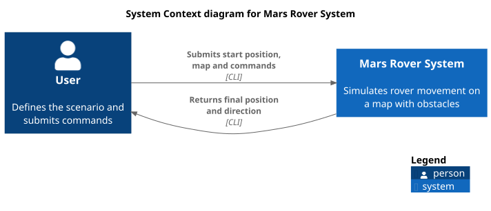

# 03 — System Scope and Context

## System Scope

The Mars Rover System simulates the movement of a single rover on a grid that contains obstacles.

**Inside scope:**

- Accepting the rover's initial position and orientation.
- Accepting a map that defines the locations of obstacles on the grid.
- Accepting and processing a sequence of movement and rotation commands.
- Enforcing obstacle avoidance: preventing the rover from moving into an obstacle position.
- Reporting the rover's resulting position and orientation.

**Outside scope:**

- Persistent storage of rover state or mission history between runs.
- Multiple concurrent rovers or missions.
- A graphical or web-based user interface.
- Network communication or remote access.
- Real hardware rover control or sensor integration.

---

## Business Context

The single external actor is the **User**, who interacts with the Mars Rover System directly through the CLI.

| Direction | Actor | Information |
|-----------|-------|-------------|
| Input | User → Mars Rover System | Initial rover position (x, y) and orientation (N, E, S, W) |
| Input | User → Mars Rover System | Map of obstacle locations on the grid |
| Input | User → Mars Rover System | Sequence of commands: move forward, turn left 90°, turn right 90° |
| Output | Mars Rover System → User | Resulting rover position and orientation after command processing |

There are no other external actors, systems, or integrations.

---

## Technical Context

The Mars Rover System is accessed exclusively through a Python command-line interface running as a single local process.

| Interaction | Technology | Description |
|-------------|------------|-------------|
| User input | CLI (stdin / arguments) | The user provides the initial position, orientation, obstacle map, and command sequence at the command line. |
| System output | CLI (stdout) | The system prints the rover's resulting position and orientation to standard output. |

No external APIs, databases, message brokers, or network services are involved. All state exists in memory for the duration of a single run and is discarded when the process exits.

---

## C4 System Context Diagram

The diagram below shows the Mars Rover System as a whole, the User as the sole external actor, and the interactions between them.

*Source: `architecture/diagrams/c4-context.puml`*
