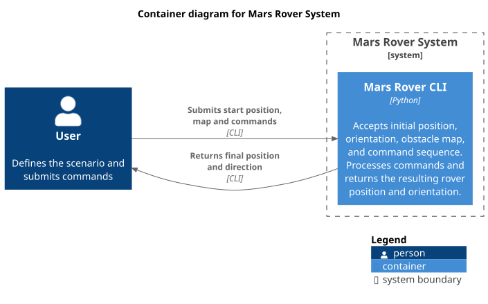
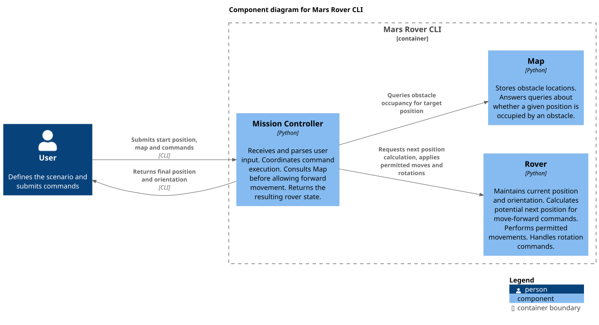

# 05 — Building Block View

## Overview

The Mars Rover System is a single Python CLI application. The Mars Rover CLI is the system's only deployable unit. Mission Controller, Rover, and Map are logical components within this application, not independently deployable processes or services.

This chapter describes the system's static structure at two levels of detail:

- **Level 1 (Container):** the single application within the system boundary.
- **Level 2 (Component):** the three logical components inside that application.

---

## Level 1: Container View

The Mars Rover System contains exactly one container: the Mars Rover CLI application. The User interacts with it directly through the command line.

| Element | Type | Description |
|---------|------|-------------|
| User | Person | Provides the initial rover position and orientation, the obstacle map, and the command sequence. Receives the resulting position and orientation. |
| Mars Rover CLI | Python application | The single runnable application. Accepts all inputs, executes the command sequence, enforces obstacle avoidance, and reports the result. Runs locally as a single process with no external dependencies. |

---

## Level 2: Component View

The Mars Rover CLI is internally structured as three logical components. These components are not separate processes or services — they are distinct units of responsibility within the same application.

### Mission Controller

**Responsibility:** Entry point and coordinator for the application.

- Receives and parses the user's input: initial position, orientation, obstacle map, and command sequence.
- Iterates over the command sequence, dispatching each command.
- For each move-forward command, queries the Map to determine whether the target position is free before instructing the Rover to move.
- For rotation commands, instructs the Rover directly without consulting the Map.
- Returns the rover's resulting position and orientation to the user.

The Mission Controller holds no domain logic for movement or grid rules. Its role is coordination.

### Rover

**Responsibility:** Position, orientation, and movement calculations.

- Maintains the rover's current position (x, y) and orientation (N, E, S, W) as mutable state.
- Given the current position and orientation, calculates the potential next position for a move-forward command without updating state.
- Applies a forward movement when the Mission Controller confirms the target position is clear. The rover's position is not updated when a movement is blocked.
- Applies left and right rotation commands, updating orientation by 90° in the requested direction.

The Rover encodes movement and rotation rules but makes no decisions about obstacle avoidance.

### Map

**Responsibility:** Obstacle storage and occupancy queries.

- Stores the set of obstacle positions provided at startup as an in-memory collection.
- Answers queries from the Mission Controller: given a position, is it occupied by an obstacle?
- The obstacle set is populated once from user input and treated as read-only during command processing.

The Map holds no knowledge of the rover's current position or the commands being executed.

---

## Component Interactions

| Interaction | From | To | Description |
|-------------|------|----|-------------|
| Calculate next position | Mission Controller | Rover | Before each move-forward, the Mission Controller asks the Rover to calculate the potential next position. |
| Query obstacle occupancy | Mission Controller | Map | The Mission Controller queries the Map with the potential next position to check whether it is blocked. |
| Apply movement | Mission Controller | Rover | If the Map reports the position is clear, the Mission Controller instructs the Rover to apply the move. |
| Apply rotation | Mission Controller | Rover | For turn commands, the Mission Controller instructs the Rover to update its orientation. |

There is no direct dependency between Rover and Map. The Mission Controller mediates all interactions between them.

---

## Design Notes

- When a move-forward command is blocked by an obstacle, the rover remains at its current position and orientation. The blocked movement is skipped, and the Mission Controller continues processing the remaining commands in sequence.
- All three components share the same process and in-memory state. There are no network calls, serialization, or inter-process communication.
- The number of Python source files used to implement these components is an implementation detail and is not constrained by this document.
