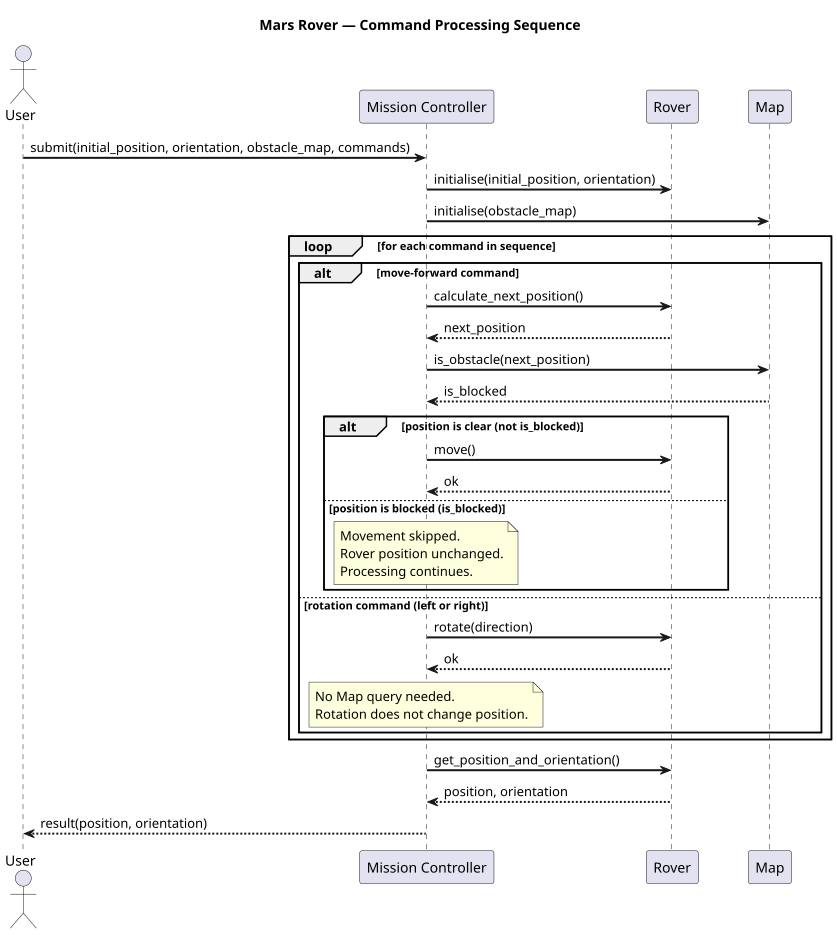

# 06 — Runtime View

This chapter describes how the Mars Rover System behaves at runtime. It covers the four key scenarios that together span the full range of system behavior: successful forward movement, blocked forward movement, rotation, and command sequence completion.

All behavior occurs within a single process. The Mission Controller, Rover, and Map interact through direct in-memory calls with no network communication or asynchronous messaging.

---

## Sequence Diagram

The diagram below illustrates the complete command-processing workflow, including all four scenarios.

---

## Scenario 1 — Successful Forward Movement

The rover advances one step in its current direction.

1. The Mission Controller receives a move-forward command from the command sequence.
2. The Mission Controller asks the Rover to calculate its potential next position, based on its current position and orientation. The Rover returns the candidate position without modifying its state.
3. The Mission Controller queries the Map with the candidate position.
4. The Map reports that the position is not occupied by an obstacle.
5. The Mission Controller instructs the Rover to apply the movement.
6. The Rover updates its position to the candidate position.

---

## Scenario 2 — Blocked Forward Movement

The rover encounters an obstacle and the move is skipped.

1. The Mission Controller receives a move-forward command.
2. The Mission Controller asks the Rover to calculate its potential next position. The Rover returns the candidate position without modifying its state.
3. The Mission Controller queries the Map with the candidate position.
4. The Map reports that the position is occupied by an obstacle.
5. The Mission Controller does not instruct the Rover to move.
6. The Rover's position and orientation remain unchanged.
7. The blocked movement is skipped. The Mission Controller continues with the next command in the sequence.

---

## Scenario 3 — Rotation

The rover turns left or right without changing its grid position.

1. The Mission Controller receives a rotation command (left or right).
2. The Mission Controller instructs the Rover to rotate in the specified direction.
3. The Rover updates its orientation by 90° and returns confirmation.
4. No Map query is made, because rotation does not change the rover's position and cannot result in a collision.

---

## Scenario 4 — Command Sequence Completion

The application returns its result after all commands have been processed.

1. The Mission Controller processes each command in the sequence in order, applying Scenarios 1, 2, or 3 as appropriate for each command.
2. When all commands have been processed, the Mission Controller retrieves the rover's current position and orientation from the Rover.
3. The application returns the resulting position and orientation to the User.

---

## Runtime Invariants

The following properties hold throughout command processing:

| Invariant | Description |
|-----------|-------------|
| Position integrity | The Rover's position is updated only when the Mission Controller explicitly instructs it to move, after the Map has confirmed the target is clear. |
| Obstacle immutability | The Map's obstacle set is populated once at startup and is not modified during command processing. |
| No direct Rover–Map dependency | The Rover never queries the Map. All obstacle checks are performed by the Mission Controller. |
| Continued processing | A blocked move does not terminate the command sequence. Subsequent commands are always processed. |
| In-memory only | No state is persisted to disk at any point during execution. |
