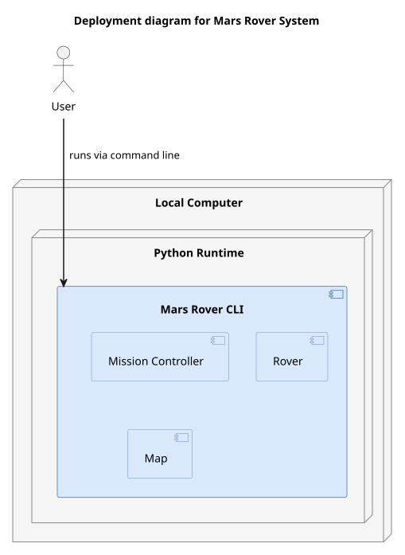

# 07 — Deployment View

## Overview

The Mars Rover System is deployed as a single local Python CLI application. There is one deployment environment: the user's own computer. No servers, cloud infrastructure, containerization technologies (such as Docker), or network services are required.

The User runs the application from a terminal. The application starts, processes the inputs and commands, prints the result, and exits. All execution occurs within a single OS process for the duration of one run.

---

## Deployment Diagram

The diagram below shows the deployment structure: the local computer, the Python runtime, the Mars Rover CLI, and the three logical components executing within it.

---

## Runtime Environment

The following environment is required to run the application.

| Requirement | Description |
|-------------|-------------|
| Python interpreter | A Python installation is required. No specific version or operating system is mandated by an approved architectural decision. |
| Python standard library | The application uses only the Python standard library. No third-party packages need to be installed. |
| Terminal | The user interacts with the application through a command-line terminal. |
| Local file system | The application source files must be accessible to the Python interpreter. No write access to the file system is required at runtime. |

There is no requirement for a database, a network connection, an application server, or any external service.

---

## Deployment Structure

The three logical components — Mission Controller, Rover, and Map — are not independently deployed. They execute together inside the single Mars Rover CLI process on the local computer.

| Element | Deployment location | Notes |
|---------|--------------------:|-------|
| Mars Rover CLI | Local computer, single OS process | The only deployable unit. Started by the user from a terminal. |
| Mission Controller | Inside the Mars Rover CLI process | Coordinates command execution for the duration of one run. |
| Rover | Inside the Mars Rover CLI process | Holds position and orientation in memory. State is discarded on exit. |
| Map | Inside the Mars Rover CLI process | Holds obstacle locations in memory. Populated at startup, read-only during execution. |

All rover state and obstacle information exist only in memory. When the process exits, all state is discarded. There is no persistence between runs.

---

## Deployment Steps

Running the application requires no installation beyond having Python available.

1. Obtain the application source files.
2. Open a terminal on the local computer.
3. Run the application using the Python interpreter, providing the required inputs.
4. Read the result printed to the terminal.

No build step, packaging, or dependency installation is required for the application itself. Development and testing tools may be installed separately without affecting the application's runtime dependencies (consistent with TC-2).
